# Week 4 - Networking & REST API

Aplikasi Flutter yang menampilkan daftar data dari REST API (JSONPlaceholder `/posts`) melalui repository + Riverpod, dikerjakan sesuai codelab "#04 | Networking & REST API".

## Fitur utama

- Model `Post` dengan `fromJson` aman null.
- Dio terpusat (base URL, timeout 10 detik, header, `LogInterceptor`) di `lib/data/api_client.dart`.
- `PostRepository`: `fetchPosts`, `fetchPostsPage` (`_page` dan `_limit`), `fetchPost`.
- `PostListPage`: empat state (loading, error + tombol "Coba lagi", empty, success), refresh.
- `PagedPostPage`: infinite scroll 10 item per halaman, guard request ganda, indikator akhir data.
- Halaman detail `/post/:id` dengan GoRouter (data dari list yang sudah dimuat, atau via repository bila dibuka langsung).
- AI Challenge: `Comment`, `CommentRepository`, `commentListProvider` (lihat `docs/ai-challenge.md`).

## Uji tiga skenario error

1. Jalankan aplikasi dengan internet normal, amati loading lalu daftar 100 posts.

| uji_internet_normal | uji_internet_normal |
|:---:|:---:|
| 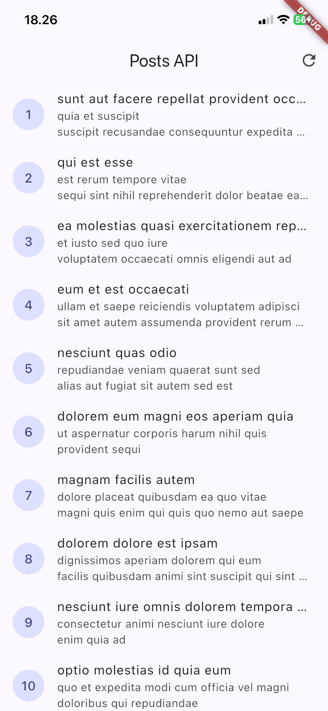 | 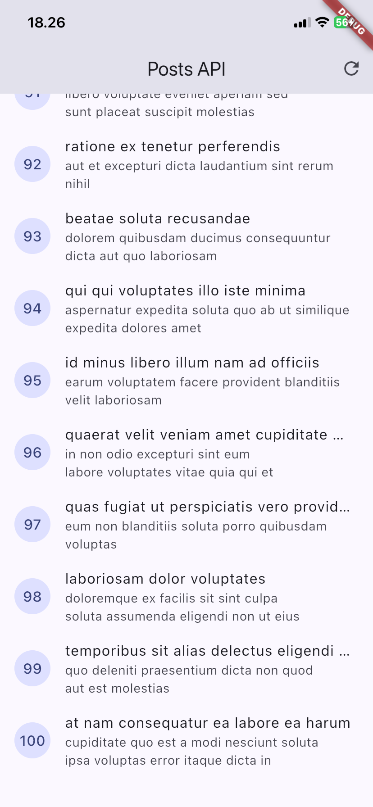 |

2. Matikan internet (mode pesawat), tekan refresh, amati pesan ramah + tombol "Coba lagi". Nyalakan kembali internet, tekan Coba lagi.

| internet_mati | internet_nyala |
|:---:|:---:|
| 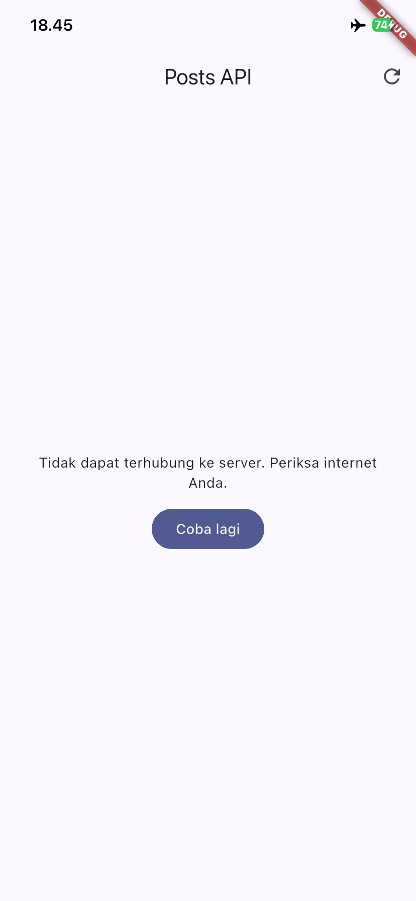 | 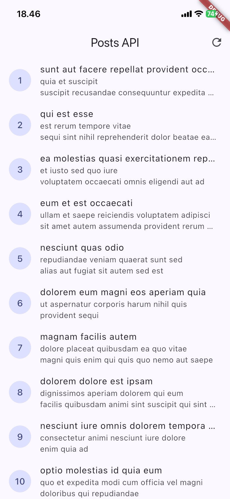 |

3. Sementara ubah baseUrl menjadi URL salah, amati pesan error koneksi. Kembalikan setelah uji.

| url_salah | hasil |
|:---:|:---:|
| 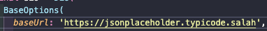 |  |

## AI Challenge

| test_hasil_AI |
|:---:|
| 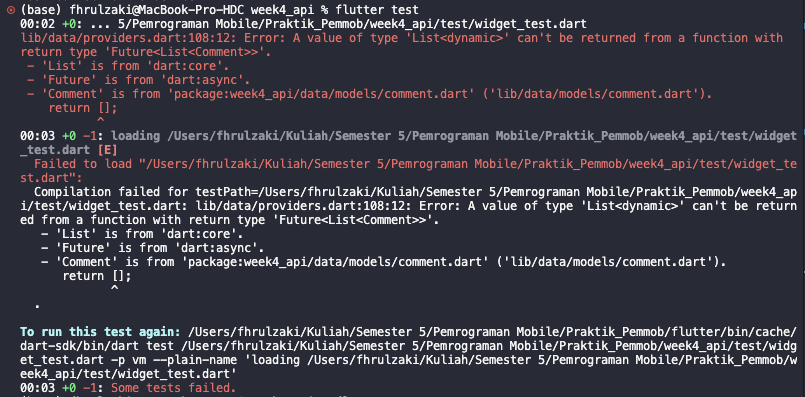 |

| kesalahan | perbaikan |
|:---:|:---:|
| 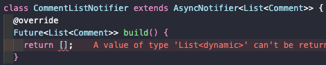 | 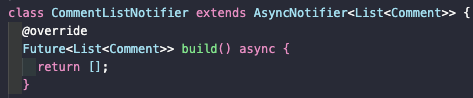 |

| test_setelah_perbaikan |
|:---:|
| 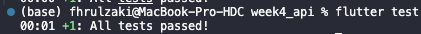 |

| menambahkan_edge_case |
|:---:|
|  |

## Refactoring dan Testing

| flutter_analyze_test |
|:---:|
| 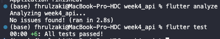 |

| hasil_1 | hasil_2 |
|:---:|:---:|
| 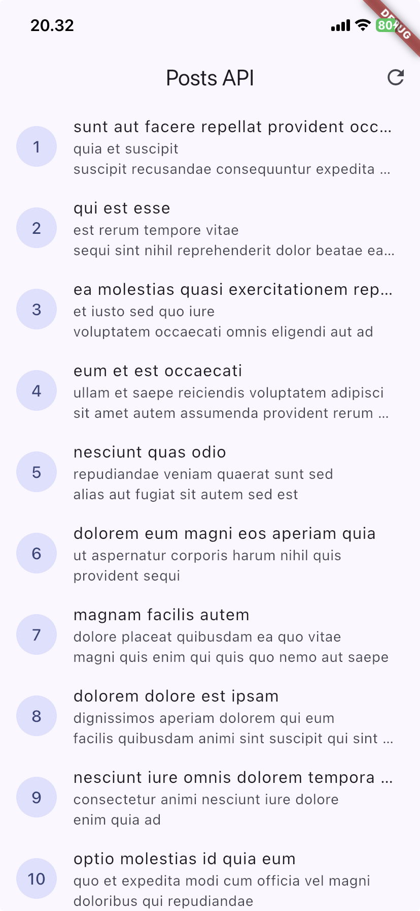 | 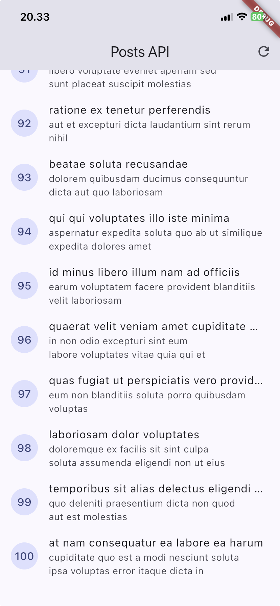 |

| hasil_detail_1 | hasil_detail_2 |
|:---:|:---:|
| 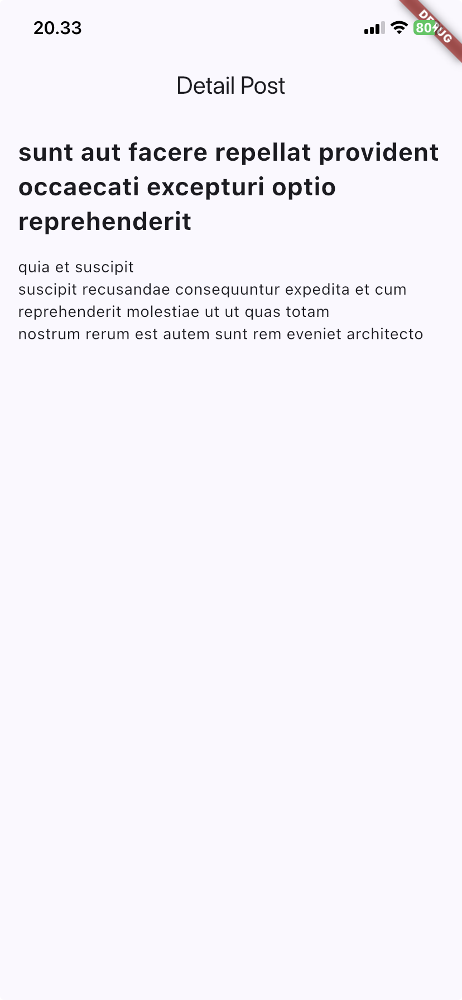 | 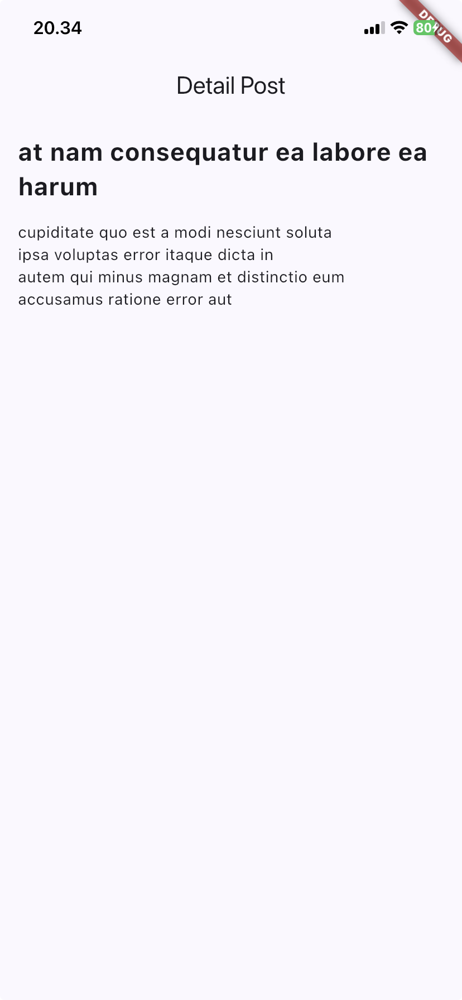 |

### Checklist Verifikasi Mandiri

* [x] **UI menggunakan Repository dan Provider.** Pengambilan data post dilakukan melalui `PostRepository` dan `postListProvider`, bukan dengan memanggil Dio langsung dari UI.

* [x] **Empat state tampilan.** Loading, error dengan tombol *Coba lagi*, empty, dan success sudah diimplementasikan. Perilaku setiap state perlu dipastikan melalui pengujian aplikasi.

* [x] **Pagination.** Halaman `PagedPostPage` menggunakan `pagedPostsProvider` untuk memuat data bertahap. Perlu diuji secara langsung untuk memastikan data bertambah saat scroll, tidak ada request ganda, dan indikator akhir data tampil.

* [x] **Pemeriksaan kode dan unit test.** Hasil `flutter analyze` menunjukkan `No issues found!` dan hasil `flutter test` menunjukkan `All tests passed!` pada pengujian yang telah dijalankan.

* [x] **Dokumentasi AI.** Hasil penggunaan AI, prompt, kode yang diverifikasi, perbaikan, dan alasan perbaikan didokumentasikan di folder `docs/`.

## Tugas, Refleksi, dan Referensi

| flutter_analyze_test |
|:---:|
| 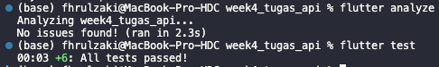 |

| hasil_1 | hasil_2 |
|:---:|:---:|
| 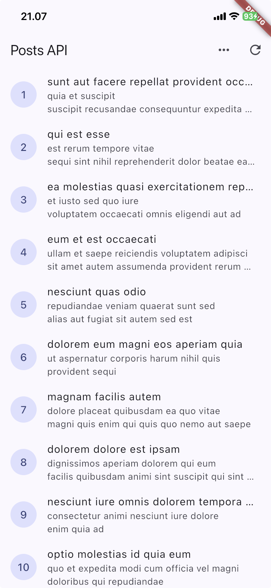 | 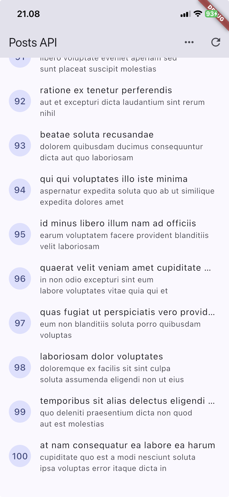 |

| hasil_detail_1 | hasil_detail_2 |
|:---:|:---:|
| 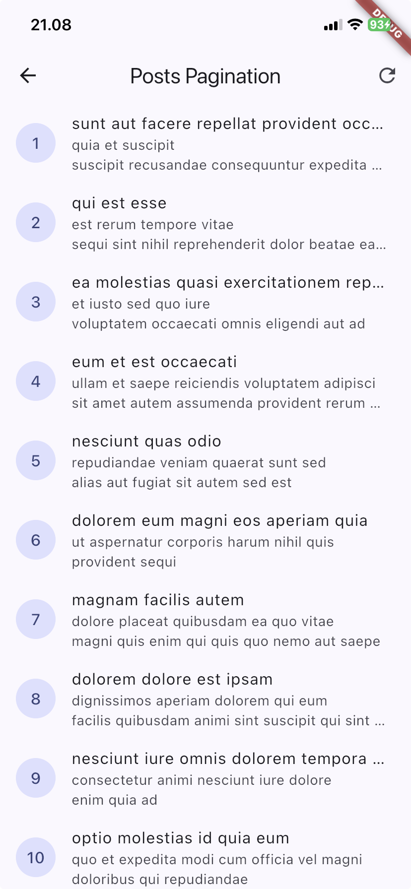 | 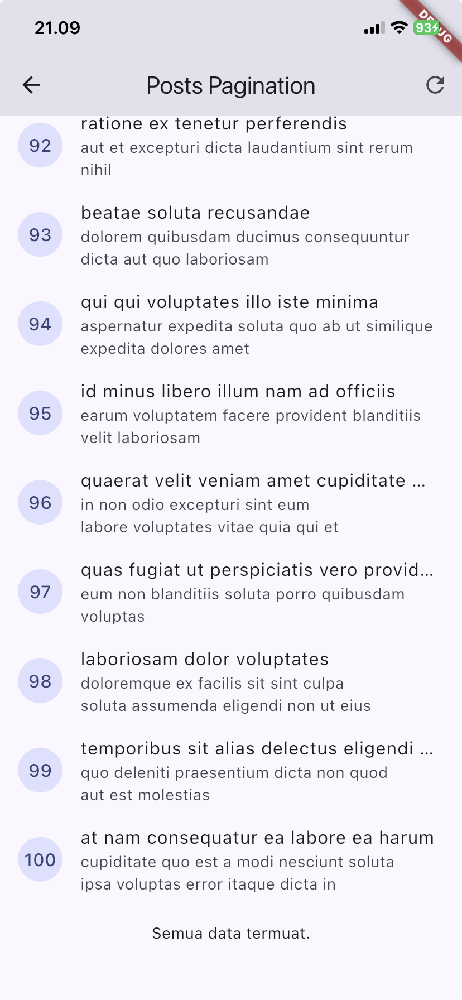 |

### Refleksi

#### 1. Mengapa UI tidak boleh memanggil Dio secara langsung? Apa yang terjadi jika aturan ini dilanggar?

UI tidak boleh memanggil Dio secara langsung karena proses pengambilan data sebaiknya dipisahkan dari tampilan aplikasi. Dio digunakan untuk komunikasi dengan API, sedangkan Repository mengelola pengambilan dan pengolahan data sebelum digunakan oleh UI.

Jika UI memanggil Dio secara langsung, kode menjadi lebih sulit dirawat dan diuji karena logika jaringan bercampur dengan tampilan. Jika terjadi perubahan API, bagian UI juga berpotensi perlu diubah.

#### 2. Kapan pagination di sisi klien cukup digunakan dan kapan harus menggunakan `_page` dan `_limit` dari server?

Pagination di sisi klien cukup digunakan ketika seluruh data sudah tersedia di aplikasi dan jumlah datanya relatif kecil. Data dapat dibagi menjadi beberapa bagian untuk ditampilkan secara bertahap.

Pagination menggunakan `_page` dan `_limit` dari server lebih sesuai ketika data berjumlah banyak. Aplikasi dapat meminta data sesuai halaman yang dibutuhkan sehingga tidak harus mengambil seluruh data sekaligus.

#### 3. Bagaimana exception dari Repository dapat menjadi `AsyncError` tanpa `try/catch` di setiap widget? Kapan `try/catch` tetap diperlukan?

Pada aplikasi yang menggunakan Riverpod, operasi asynchronous yang dijalankan melalui provider dapat menghasilkan status error ketika terjadi exception. Riverpod kemudian menyediakan status tersebut melalui `AsyncValue`, sehingga UI dapat menampilkan kondisi error tanpa harus menulis `try/catch` di setiap widget.

`try/catch` tetap diperlukan ketika kode perlu menangani exception secara khusus, misalnya untuk mengubah error menjadi pesan tertentu, menjalankan proses pemulihan, atau melakukan tindakan tambahan sebelum error diteruskan.

#### 4. Output AI apa yang diperbaiki dan mengapa?

Output AI perlu diperiksa dan disesuaikan dengan kebutuhan modul serta struktur project. Pada pengembangan model `Comment`, penanganan field yang hilang atau bernilai `null` perlu dipastikan agar proses parsing JSON tidak menyebabkan error dan tetap menghasilkan nilai default yang sesuai.

Selain itu, kode harus diperiksa melalui `flutter analyze` dan `flutter test`. Perbaikan dilakukan jika ditemukan ketidaksesuaian struktur kode, kesalahan tipe data, atau pengujian yang gagal. Dengan demikian, kode yang digunakan bukan hanya berdasarkan hasil AI, tetapi juga disesuaikan dan diverifikasi.
