# **Local Storage & Offline First**

## Pengujian SQLite CRUD

| halaman_awal |
|:---:|
| 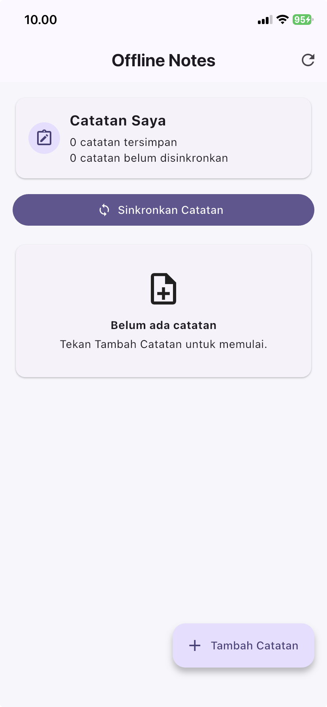 |

| tambahkan_catatan | setelah_keluar_app |
|:---:|:---:|
| 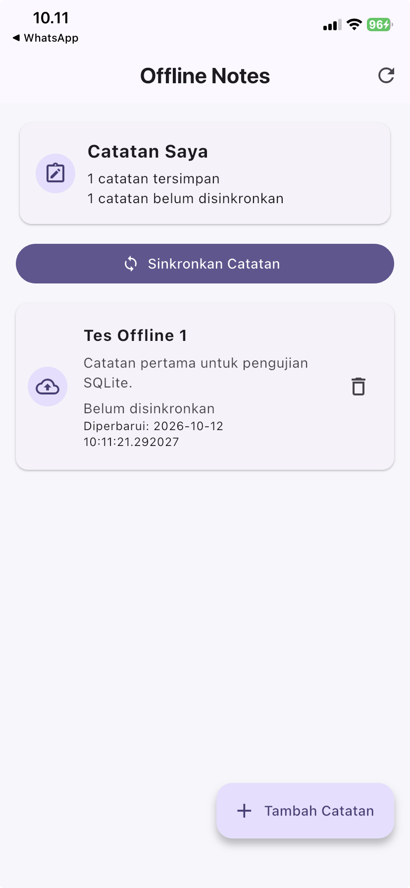 | 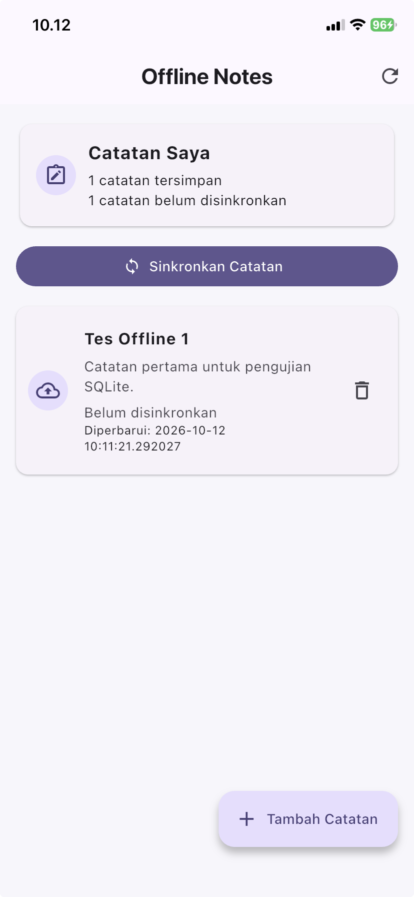 |

| tes_hapus | dihapus |
|:---:|:---:|
| 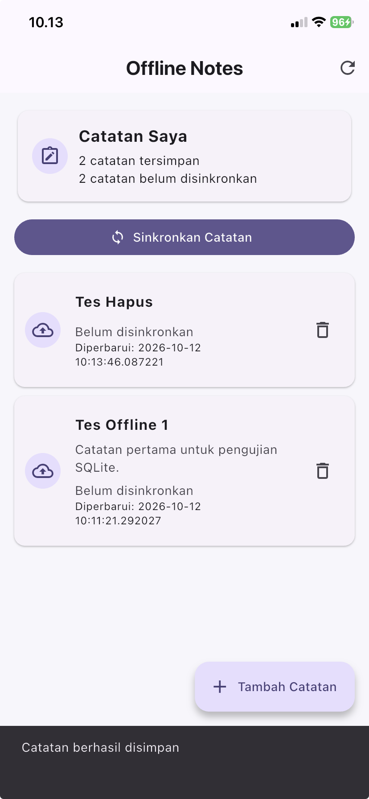 | 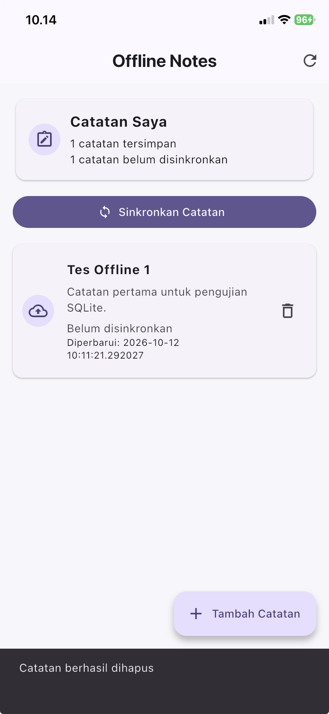 |

| keluar_buka_apps |
|:---:|
| 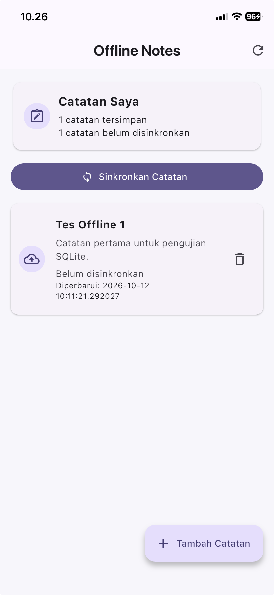 |

## Offline First

| halaman_offline |
|:---:|
| 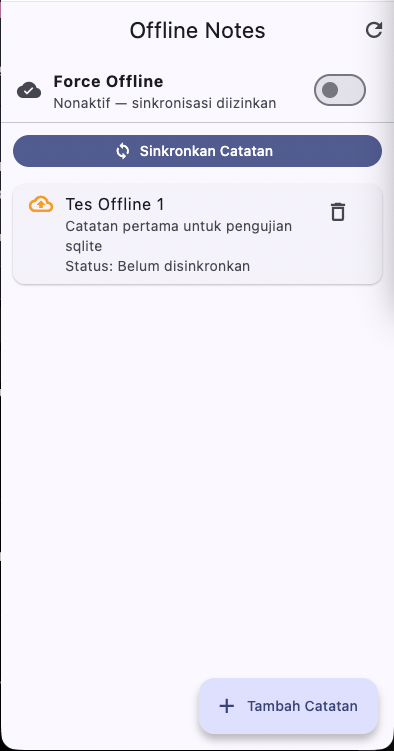 |

| buat_catatan | buka_kembali |
|:---:|:---:|
| 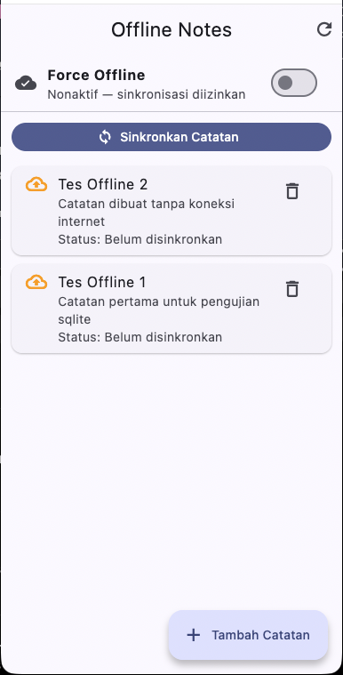 | 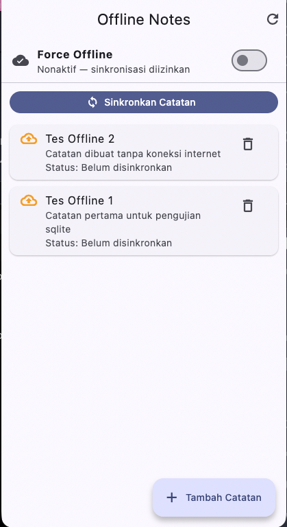 |

| force_offline_aktif | sinkronisasi_offline |
|:---:|:---:|
| 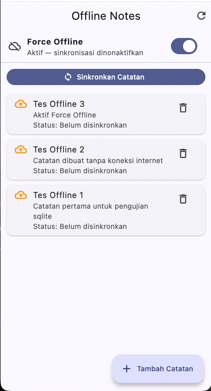 | 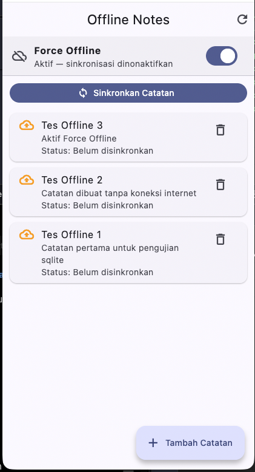 |

| sinkronisasi |
|:---:|
| 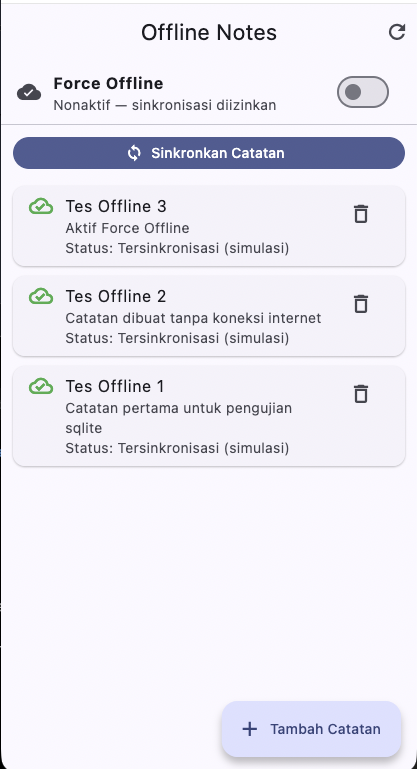 |

## AI Challenge

| flutter_analyze_test |
|:---:|
| 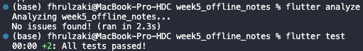 |

| halaman_awal |
|:---:|
| 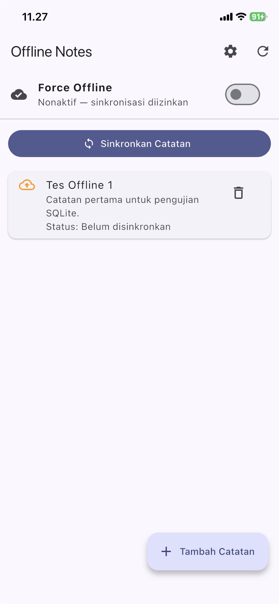 |

| tambah_catatan | buka_kembali |
|:---:|:---:|
| 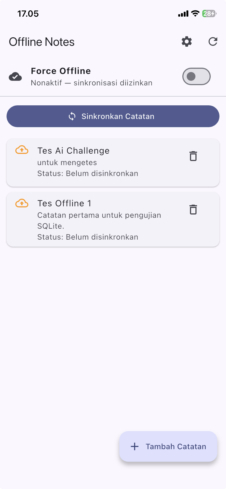 |  |

| tambah_catatan_offline | buka_kembali_offline |
|:---:|:---:|
| 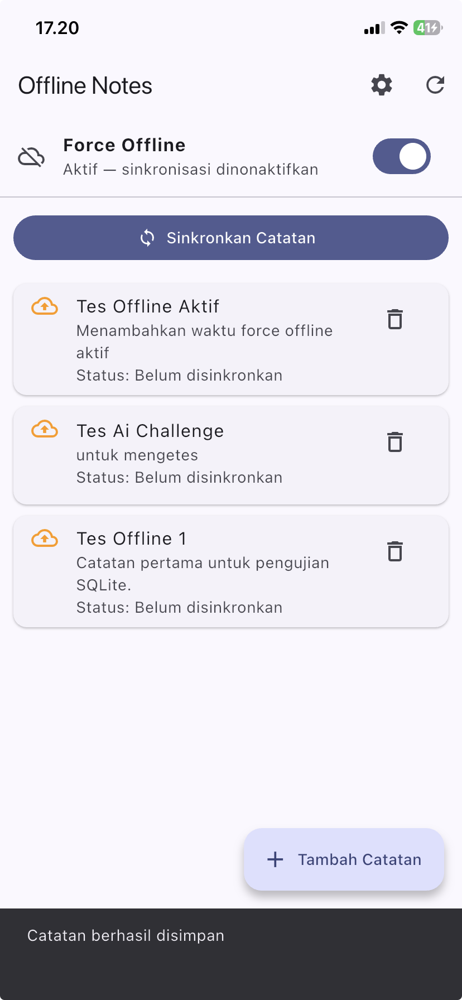 | 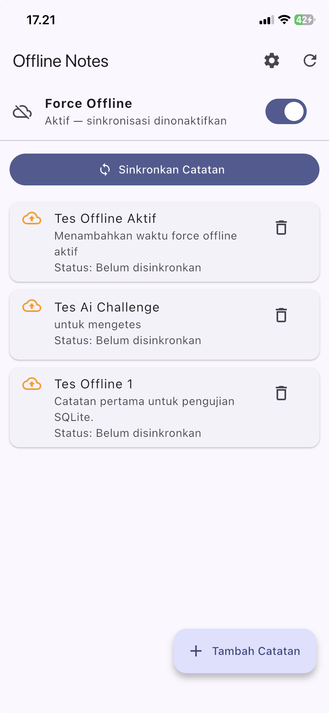 |

| sinkronisasi_aktif | sinkronisasi_mati |
|:---:|:---:|
| 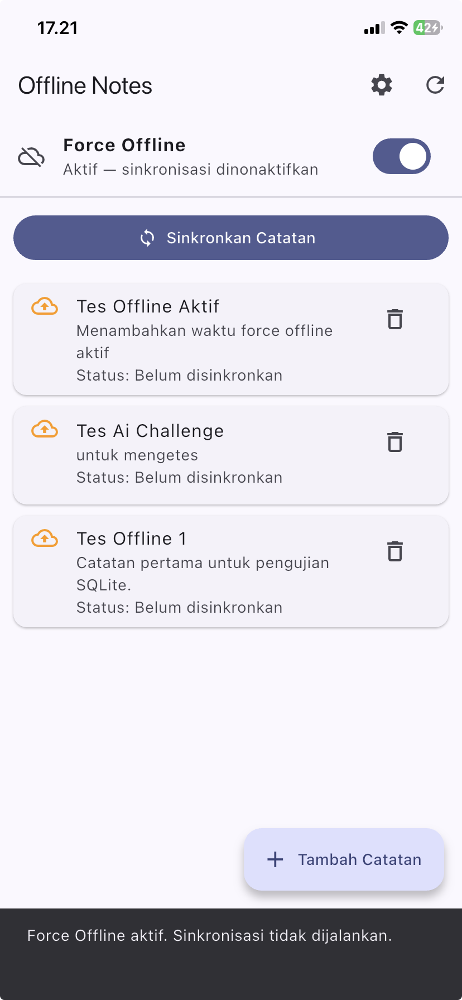 | 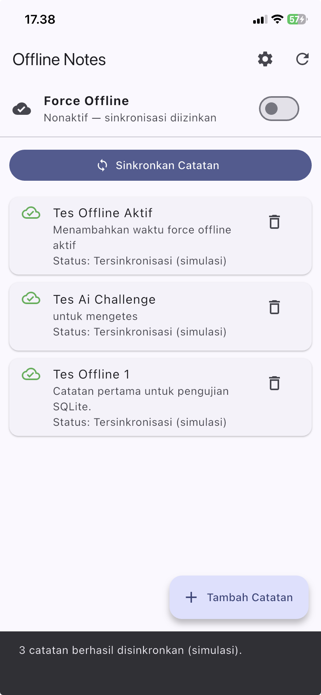 |

| ubah_gelap | buka_kembali |
|:---:|:---:|
| 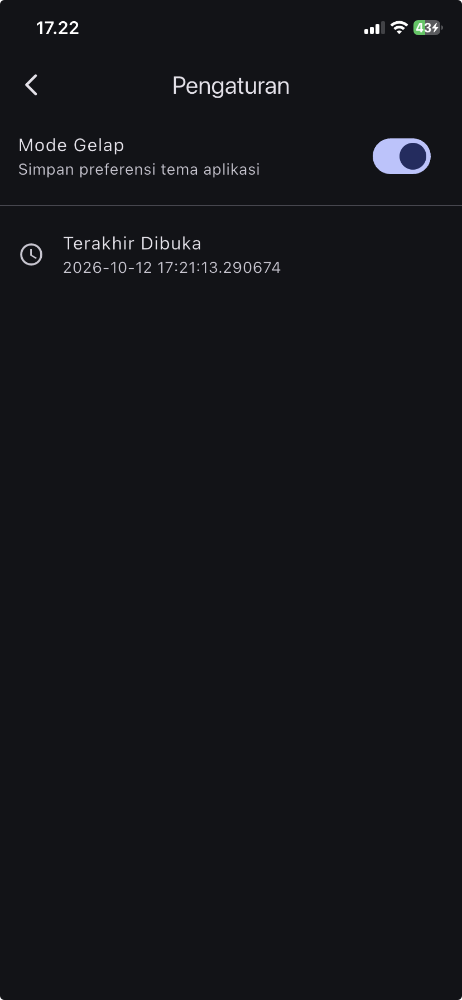 | 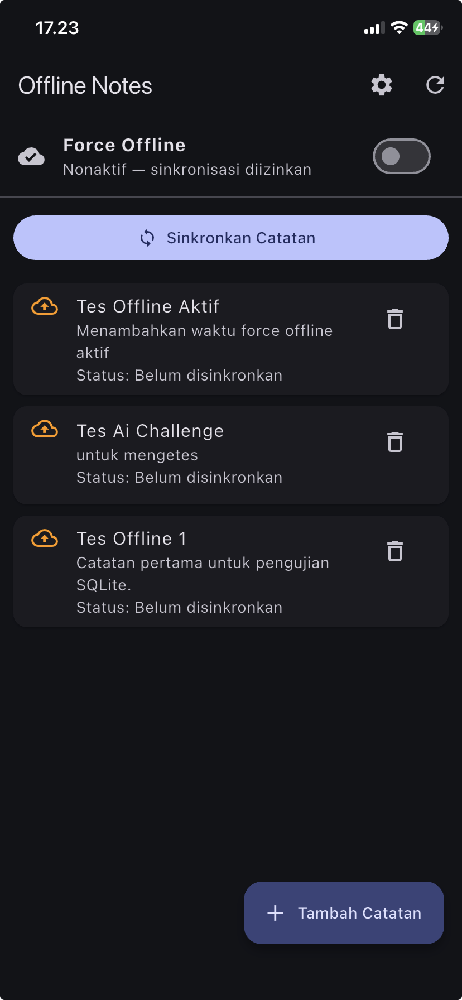 |

### AI Verification Checklist

1. **Apakah AI menempatkan daftar catatan di SharedPreferences?**
   Tidak. Daftar catatan disimpan menggunakan SQLite karena lebih sesuai untuk menyimpan koleksi data yang membutuhkan operasi CRUD. SharedPreferences digunakan untuk menyimpan preferensi tema dan waktu terakhir aplikasi dibuka.

2. **Apakah skema AI mendukung antrean sync (`dirty flag` / `updated_at`) atau hanya CRUD polos?**
   Ya. Model `Note` memiliki atribut `dirty` dan `updatedAt` untuk menandai catatan yang belum disinkronkan serta mencatat waktu pembaruan. Proses sinkronisasi masih berupa simulasi.

3. **Apakah klaim "real-time" AI didukung stream (Drift/watch) atau hanya asumsi?**
   Implementasi belum menggunakan stream dari Drift atau mekanisme `watch`. Pembaruan data dilakukan melalui pemanggilan ulang fungsi untuk membaca data, sehingga belum dapat diklaim sebagai pembaruan real-time berbasis stream.

4. **Apakah estimasi boilerplate AI masuk akal setelah Anda mencoba instalasinya (`flutter pub add` + migrasi skema)?**
   Proyek menggunakan `shared_preferences`, `sqflite`, dan `path` sebagai dependensi penyimpanan lokal. Skema tabel dibuat melalui kode inisialisasi database. Kesesuaian estimasi boilerplate dinilai berdasarkan proses instalasi dependensi dan pengujian implementasi pada proyek.

5. **Keputusan final beserta alasannya**
   SQLite dipilih untuk menyimpan catatan karena mendukung operasi CRUD dan penyimpanan data terstruktur. SharedPreferences digunakan untuk preferensi sederhana. Atribut `dirty` dan `updatedAt` disertakan untuk mendukung proses sinkronisasi. Sinkronisasi saat ini masih berupa simulasi dan implementasi belum menggunakan stream real-time.

## Refactoring, testing, dan error umum

| flutter_analyze | flutter_test |
|:---:|:---:|
| 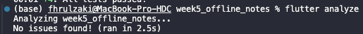 | 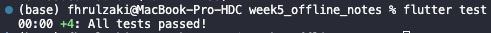 |

### Checklist verifikasi mandiri

- [x] UI tidak memanggil SQLite/SharedPreferences langsung; semua lewat repository + provider.
- [x] Aplikasi penuh berfungsi dalam mode pesawat: baca, tambah, hapus catatan.
- [x] Badge dirty akurat sebelum/sesudah sync; cache posts tampil tanpa internet.
- [x] `flutter analyze` tanpa issue dan semua test lulus.
- [x] Hasil AI diverifikasi dan didokumentasikan pada folder `docs/`.

## Tugas dan Refleksi

| flutter_analyze | flutter_test |
|:---:|:---:|
| 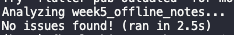 | 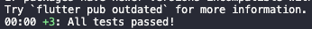 |

### Hasil

| halaman_awal |
|:---:|
| 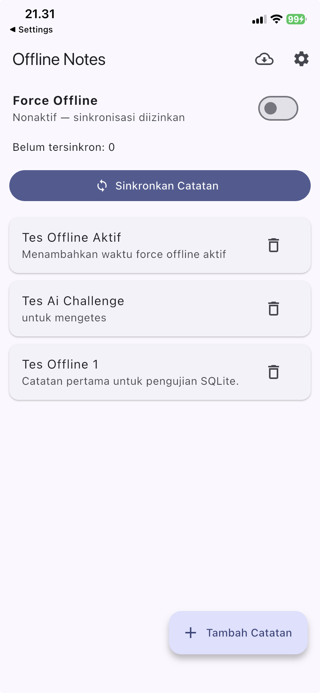 |

| menambahkan_catatan_offline |
|:---:|
| 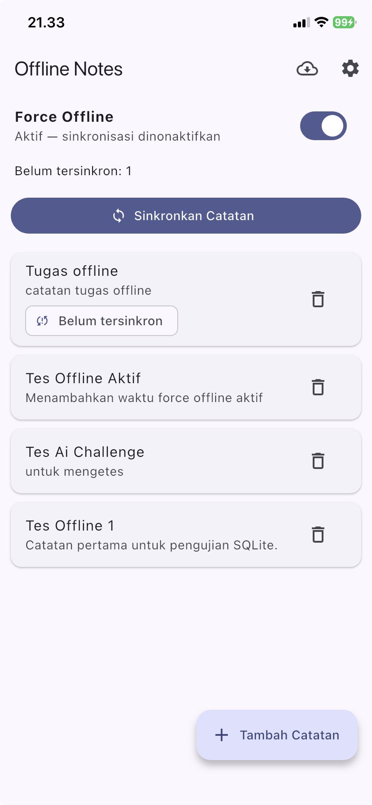 |

| menyinkronkan |
|:---:|
| 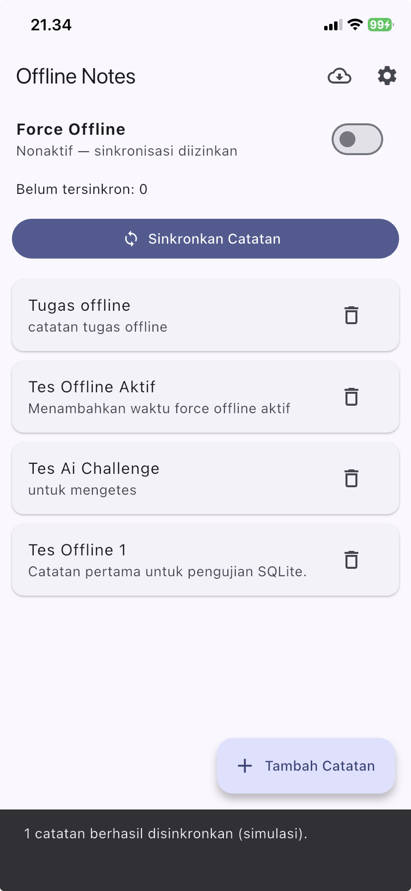 |

| mode_gelap |
|:---:|
| 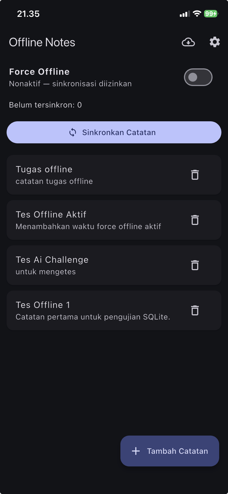 |

### Refleksi

- **Mengapa daftar catatan tidak boleh disimpan di SharedPreferences? Apa yang rusak jika aturan ini dilanggar?**  
  Karena SharedPreferences digunakan untuk data sederhana berupa key-value, bukan data terstruktur seperti daftar catatan. Jika dipaksakan, pengelolaan CRUD, pencarian, dan perubahan data menjadi lebih sulit serta tidak efisien.

- **Kapan cache-first cukup, dan kapan membutuhkan strategi lain?**
  Cache-first cukup ketika data lokal masih dapat digunakan dan tidak harus selalu terbaru, seperti catatan. Untuk data yang harus selalu terbaru, seperti harga real-time, lebih tepat menggunakan network-first agar aplikasi mengambil data terbaru dari server.

- **Bagaimana dirty flag berubah menjadi antrean sync tanpa memblokir UI? Kapan antrean terpisah (tabel outbox) menjadi perlu?**
  Data yang memiliki `dirty = true` dianggap sebagai data yang perlu disinkronkan. Proses sync dapat dijalankan secara asynchronous di background sehingga UI tetap dapat digunakan. Tabel outbox diperlukan jika jumlah perubahan semakin banyak atau membutuhkan antrean operasi yang lebih terstruktur dan dapat menyimpan setiap operasi yang belum berhasil dikirim.

- **Bagian mana dari rekomendasi AI yang ditolak, dan mengapa?**
  Rekomendasi AI yang menyimpan daftar catatan di SharedPreferences ditolak karena tidak sesuai untuk data terstruktur dan operasi CRUD. Untuk catatan, SQLite lebih sesuai karena mendukung tabel, query, dan pengelolaan data yang lebih baik.

## Week 7 — Clean Architecture

### Tahap 1 — Step 1 + Step 2: Konsep SOLID dan Clean Architecture

**Status:** selesai sebagai dokumentasi konseptual.

Tahap ini mendokumentasikan SOLID, tiga layer Clean Architecture, arah dependensi, feature-first dan layer-first, entity dan model, kontrak serta implementasi repository, Dependency Injection, pertimbangan use case, trade-off, dan keputusan arsitektur untuk refactoring tahap berikutnya.

Dokumentasi: [Konsep SOLID dan Clean Architecture](docs/clean-architecture-concepts.md)

Tidak ada source code yang diubah dan tidak ada refactoring pada tahap ini. Screenshot test tidak dibuat karena tahap ini bersifat konseptual. `flutter analyze` dan `flutter test` berstatus **BLOCKED** karena `pubspec.yaml` serta metadata dependency tidak tersedia di repository; keduanya tidak diklaim PASS.

### Tahap 2 — Step 3: Audit layer project lama

**Status:** selesai sebagai audit dan dokumentasi; refactoring belum dimulai.

Project Minggu 5 dipetakan ke presentation, domain/data yang masih bercampur, serta data/infrastruktur. Audit menemukan entity `Note` masih menangani mapping SQLite, repository masih mencampur kontrak dan implementasi, provider masih membuat dependency konkret, dan beberapa page/widget masih bergantung langsung pada tipe dari folder data.

Dokumentasi lengkap, hasil tiga pencarian arsitektur, daftar temuan, rencana refactor, dan rancangan feature-first tersedia di [Audit arsitektur project lama](docs/architecture-audit.md).

Tiga pencarian Codelab telah dijalankan. Pencarian akses infrastruktur dan parsing pada `lib/pages`/`lib/widgets` tidak menghasilkan output. Pencarian path `lib/providers` tidak dapat dijalankan persis karena project menggunakan `lib/data/providers.dart`; pencarian yang disesuaikan menemukan wiring repository dan Dio di provider data. Tidak ada source code yang diubah pada tahap ini.

`flutter analyze` dan `flutter test` tetap **BLOCKED** karena `pubspec.yaml` serta metadata dependency tidak tersedia di repository. Screenshot tidak dibuat karena bukti tahap ini berupa tabel dan output pencarian tekstual.
