# **Local Storage & Offline First**

## Pengujian SQLite CRUD

| halaman_awal |
|:---:|
| 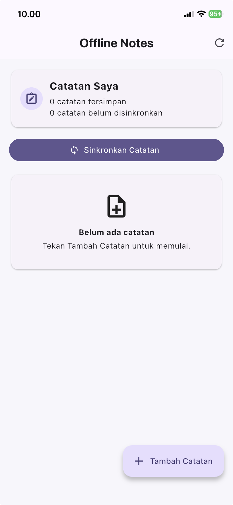 |

| tambahkan_catatan | setelah_keluar_app |
|:---:|:---:|
| 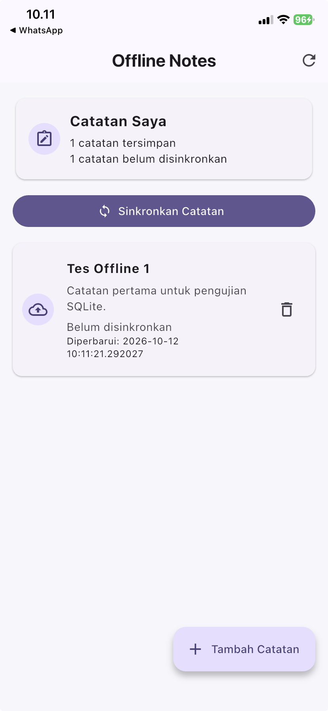 | 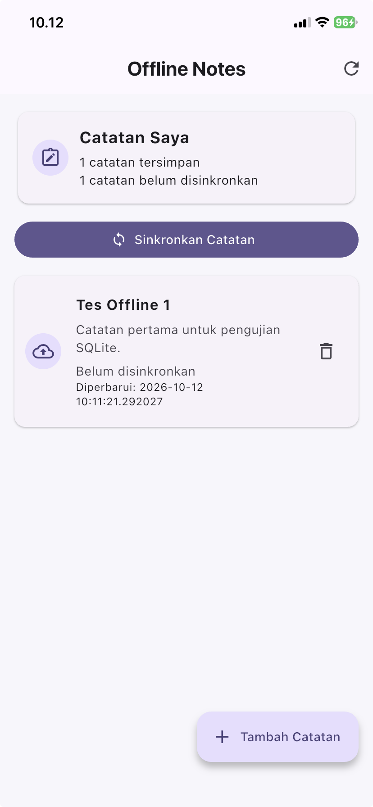 |

| tes_hapus | dihapus |
|:---:|:---:|
| 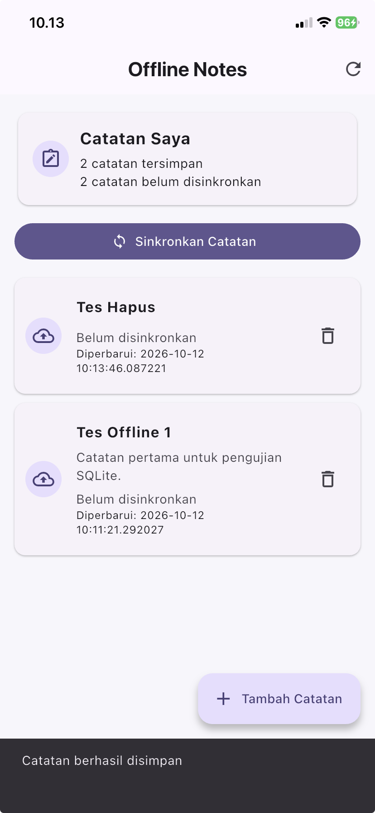 | 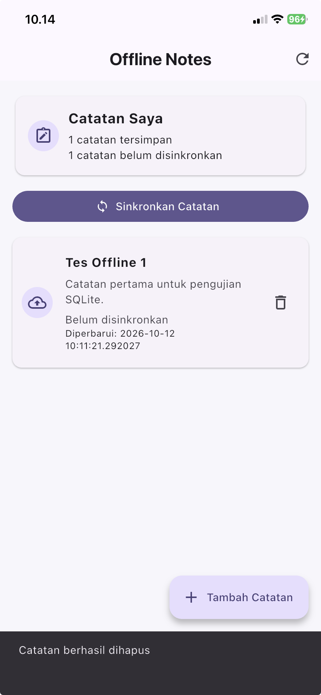 |

| keluar_buka_apps |
|:---:|
| 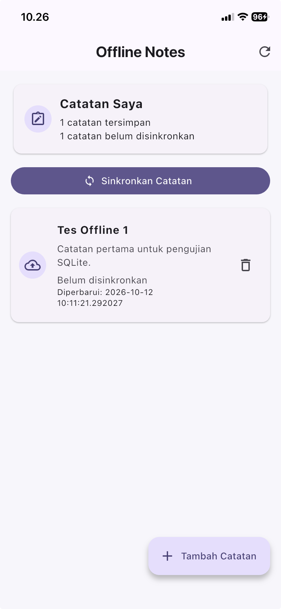 |

## Offline First

| halaman_offline |
|:---:|
| 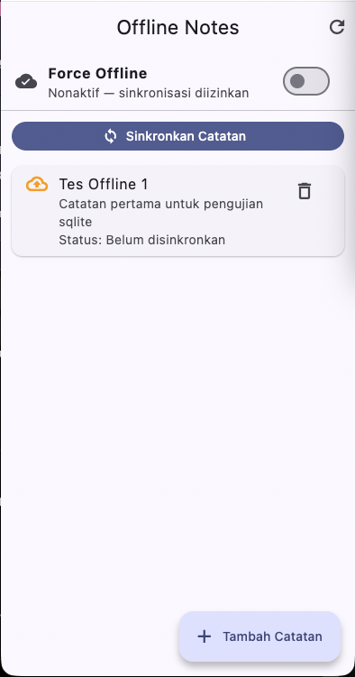 |

| buat_catatan | buka_kembali |
|:---:|:---:|
| 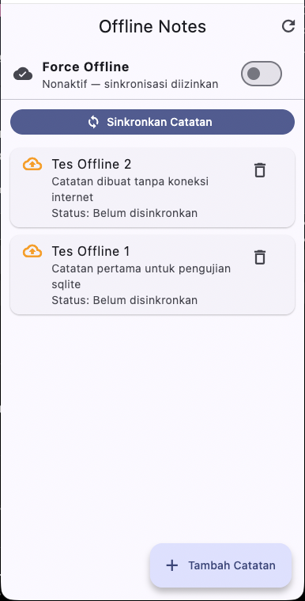 | 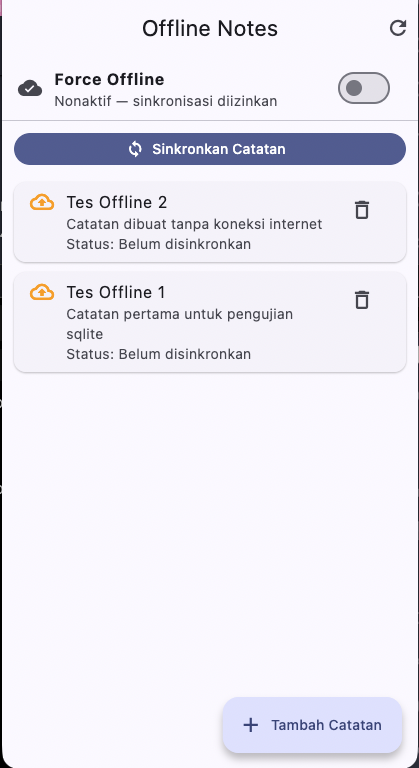 |

| force_offline_aktif | sinkronisasi_offline |
|:---:|:---:|
| 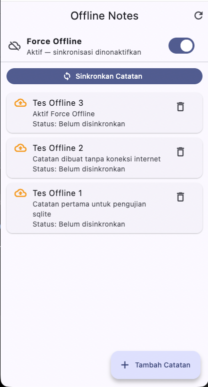 | 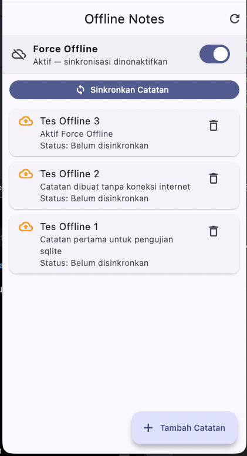 |

| sinkronisasi |
|:---:|
| 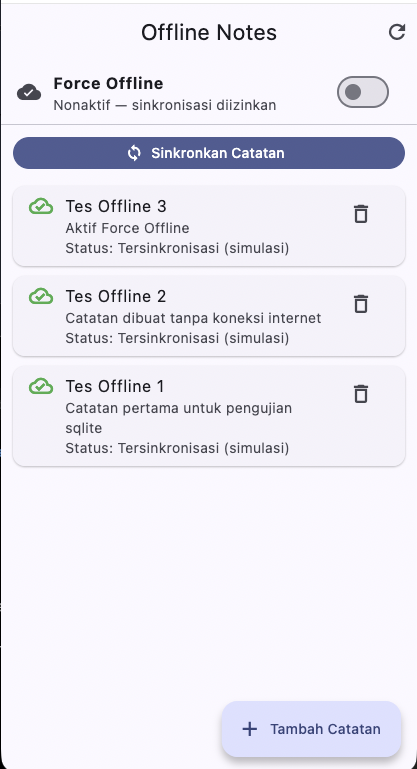 |

## AI Challenge

| flutter_analyze_test |
|:---:|
| 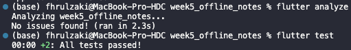 |

| halaman_awal |
|:---:|
| 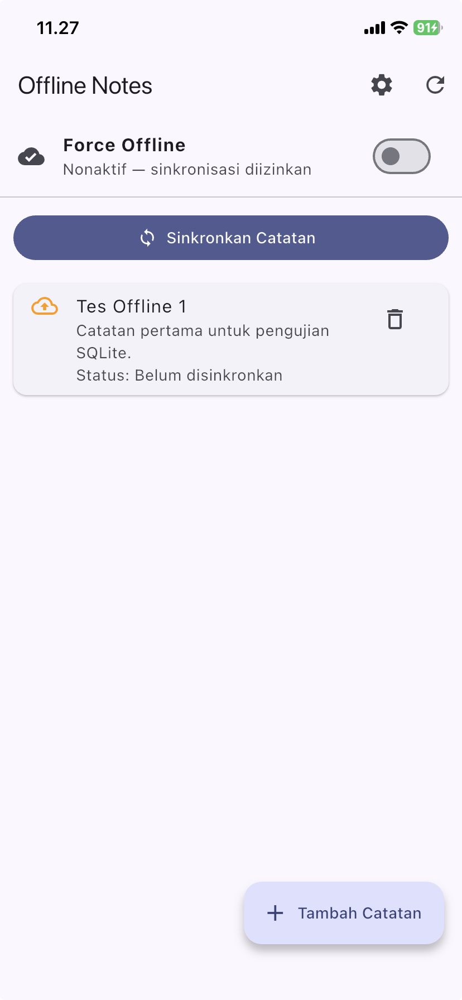 |

| tambah_catatan | buka_kembali |
|:---:|:---:|
| 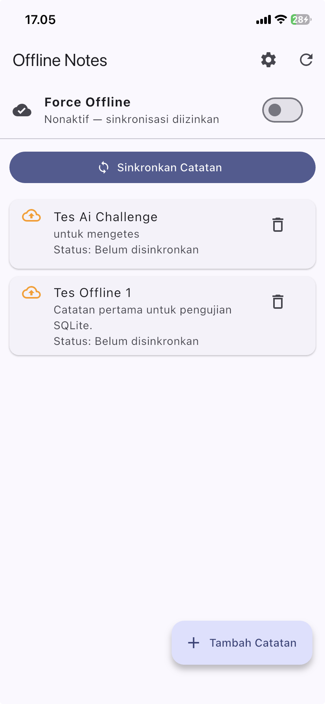 |  |

| tambah_catatan_offline | buka_kembali_offline |
|:---:|:---:|
| 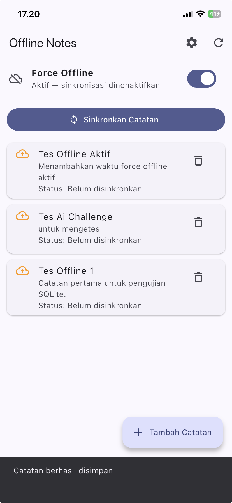 | 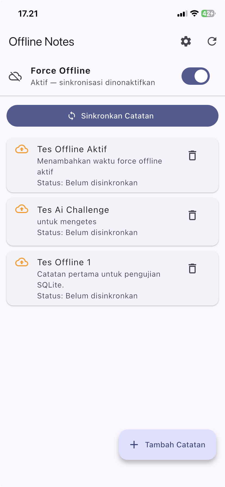 |

| sinkronisasi_aktif | sinkronisasi_mati |
|:---:|:---:|
| 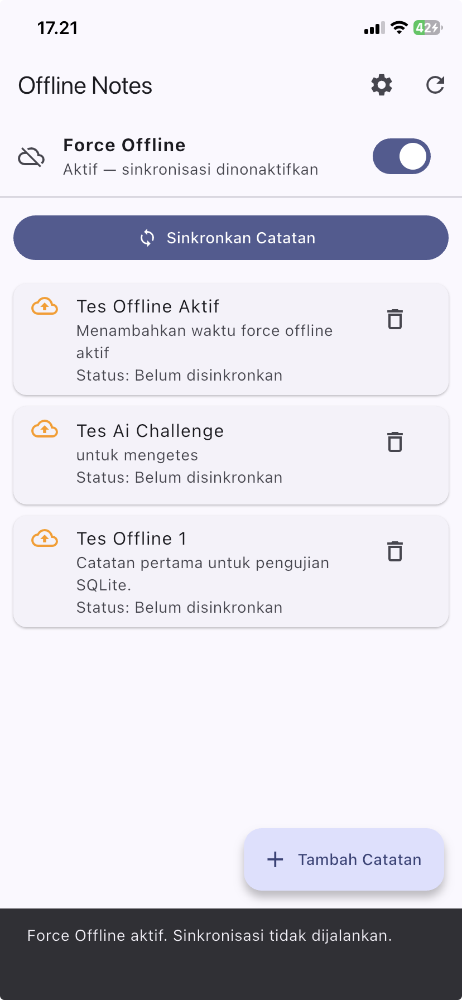 | 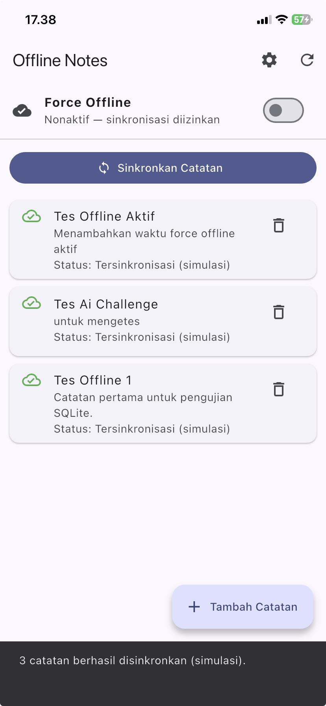 |

| ubah_gelap | buka_kembali |
|:---:|:---:|
| 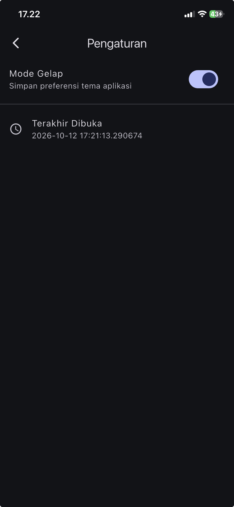 | 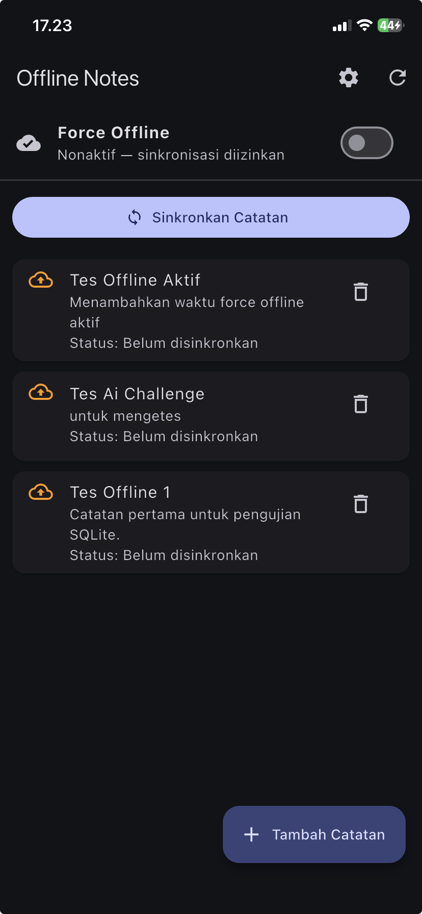 |

### AI Verification Checklist

1. **Apakah AI menempatkan daftar catatan di SharedPreferences?**
   Tidak. Daftar catatan disimpan menggunakan SQLite karena lebih sesuai untuk menyimpan koleksi data yang membutuhkan operasi CRUD. SharedPreferences digunakan untuk menyimpan preferensi tema dan waktu terakhir aplikasi dibuka.

2. **Apakah skema AI mendukung antrean sync (`dirty flag` / `updated_at`) atau hanya CRUD polos?**
   Ya. Model `Note` memiliki atribut `dirty` dan `updatedAt` untuk menandai catatan yang belum disinkronkan serta mencatat waktu pembaruan. Proses sinkronisasi masih berupa simulasi.

3. **Apakah klaim "real-time" AI didukung stream (Drift/watch) atau hanya asumsi?**
   Implementasi belum menggunakan stream dari Drift atau mekanisme `watch`. Pembaruan data dilakukan melalui pemanggilan ulang fungsi untuk membaca data, sehingga belum dapat diklaim sebagai pembaruan real-time berbasis stream.

4. **Apakah estimasi boilerplate AI masuk akal setelah Anda mencoba instalasinya (`flutter pub add` + migrasi skema)?**
   Proyek menggunakan `shared_preferences`, `sqflite`, dan `path` sebagai dependensi penyimpanan lokal. Skema tabel dibuat melalui kode inisialisasi database. Kesesuaian estimasi boilerplate dinilai berdasarkan proses instalasi dependensi dan pengujian implementasi pada proyek.

5. **Keputusan final beserta alasannya**
   SQLite dipilih untuk menyimpan catatan karena mendukung operasi CRUD dan penyimpanan data terstruktur. SharedPreferences digunakan untuk preferensi sederhana. Atribut `dirty` dan `updatedAt` disertakan untuk mendukung proses sinkronisasi. Sinkronisasi saat ini masih berupa simulasi dan implementasi belum menggunakan stream real-time.

## Refactoring, testing, dan error umum

| flutter_analyze | flutter_test |
|:---:|:---:|
| 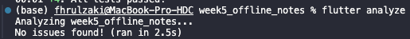 | 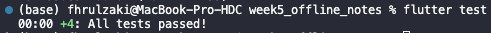 |

### Checklist verifikasi mandiri

- [x] UI tidak memanggil SQLite/SharedPreferences langsung; semua lewat repository + provider.
- [x] Aplikasi penuh berfungsi dalam mode pesawat: baca, tambah, hapus catatan.
- [x] Badge dirty akurat sebelum/sesudah sync; cache posts tampil tanpa internet.
- [x] `flutter analyze` tanpa issue dan semua test lulus.
- [x] Hasil AI diverifikasi dan didokumentasikan pada folder `docs/`.