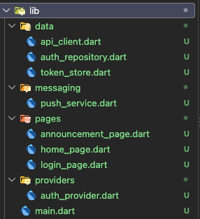
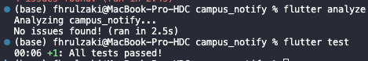
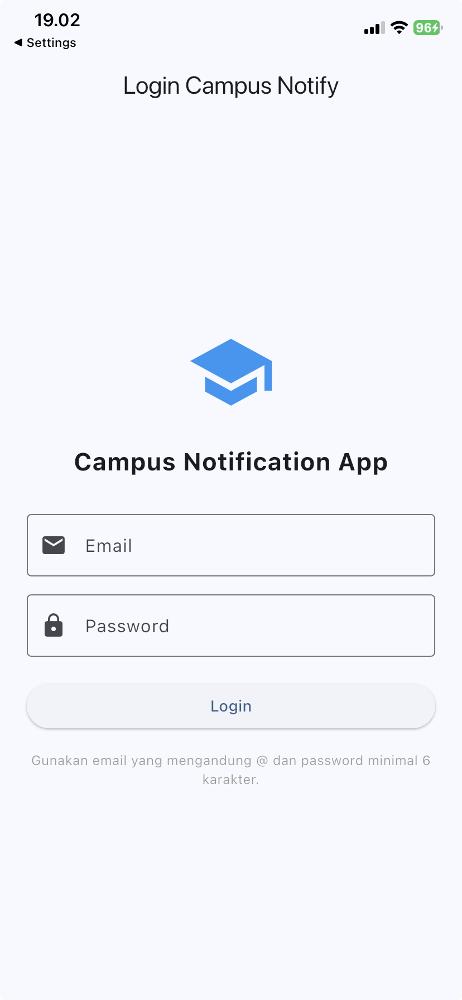
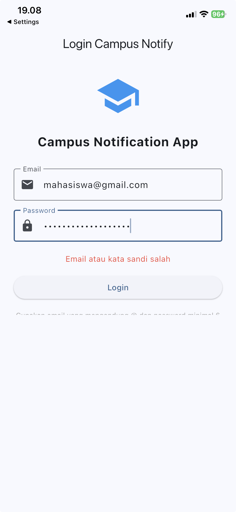
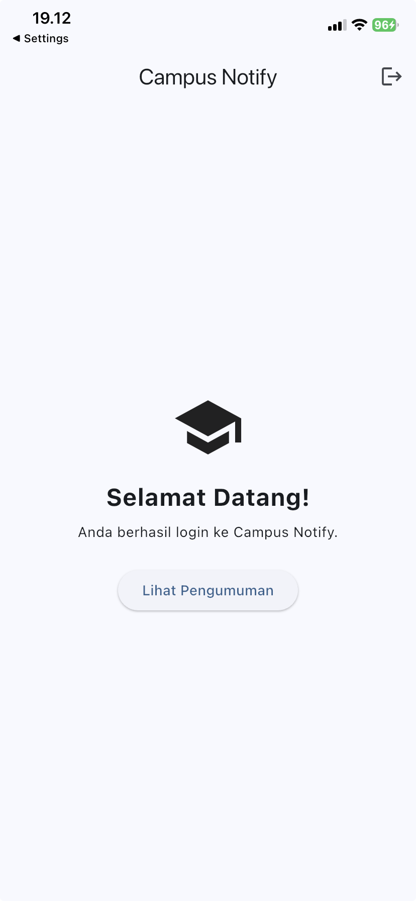
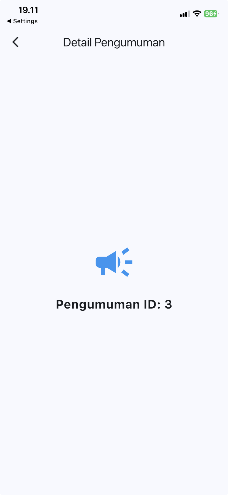
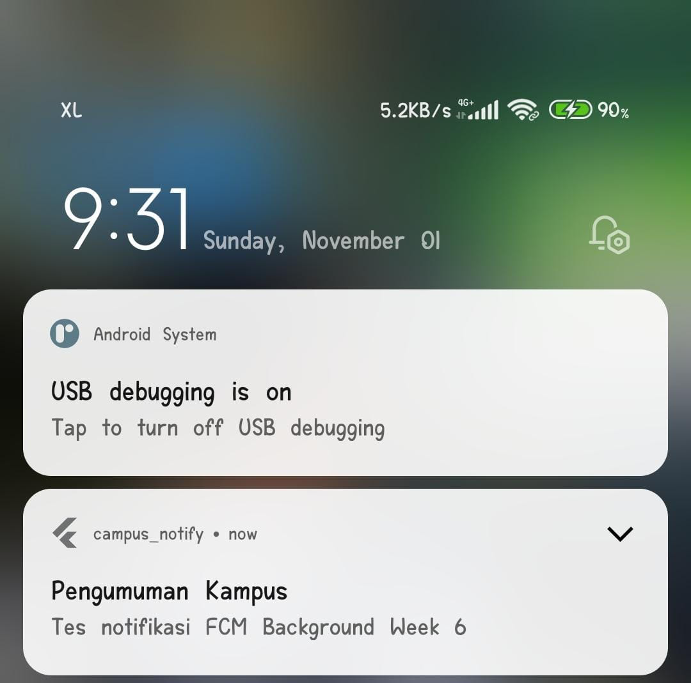
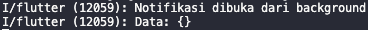

# **Week 6 Authentication, Security, & FCM**

## Praktikum 1: Login + secure storage + token refresh

| struktur folder |
|:---:|
|  |

| flutter analyze dan flutter test |
|:---:|
|  |

### Hasil

| halaman login |
|:---:|
|  |

| login tidak valid |
|:---:|
|  |

| login valid |
|:---:|
|  |

| halaman pengumuman |
|:---:|
|  |

## Praktikum 2: FCM, permission, dan token lifecycle

| notifikasi |
|:---:|
|  |

| console log |
|:---:|
|  |

**Pengujian Notifikasi FCM pada State Background**

Pengujian dilakukan dengan menjalankan aplikasi Campus Notify, kemudian memindahkannya ke background. Notifikasi dikirim melalui Firebase Console dengan target topic `pengumuman-kampus`. Banner notifikasi berhasil muncul pada perangkat Android. Setelah banner diklik, aplikasi Campus Notify terbuka kembali. Pada terminal juga muncul log `Notifikasi dibuka dari background`.

**Hasil:** Berhasil. Notifikasi dapat diterima dan dibuka ketika aplikasi berada dalam kondisi background.

## Praktikum 3: FCM, permission, dan token lifecycle