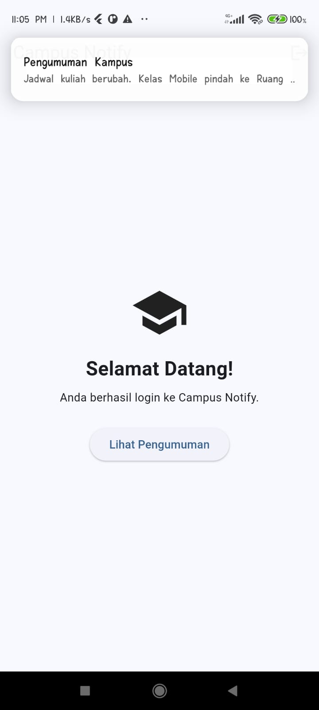
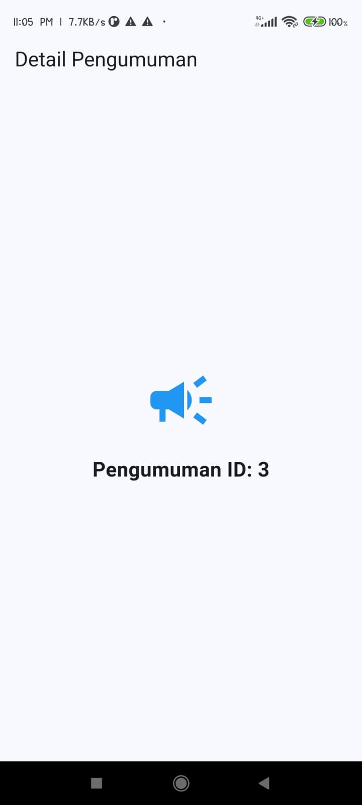
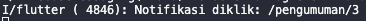
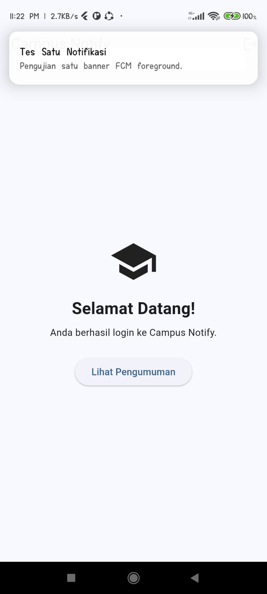
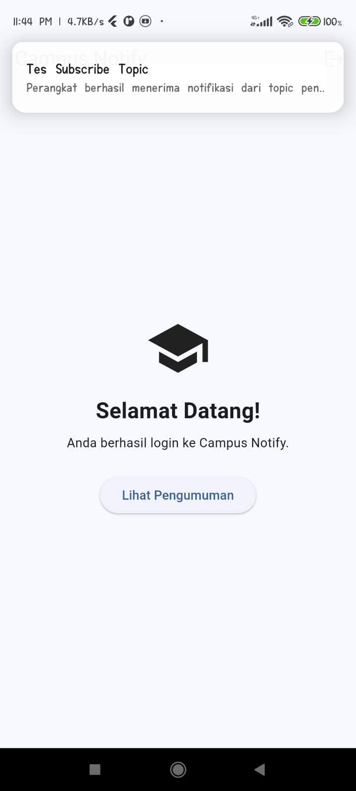
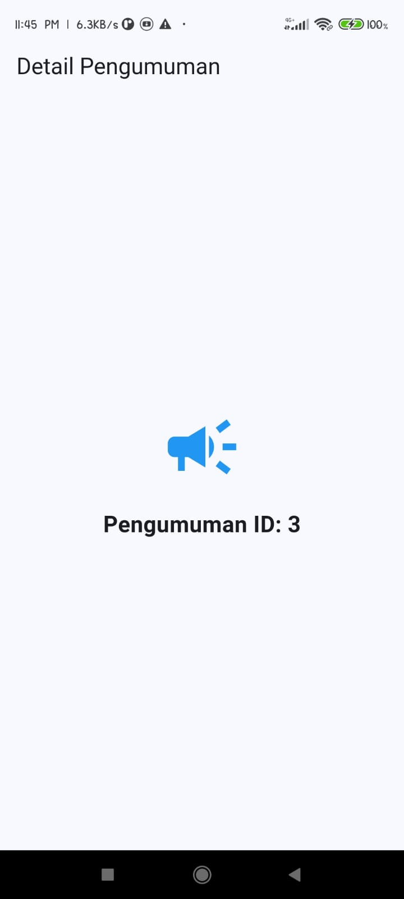
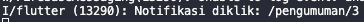
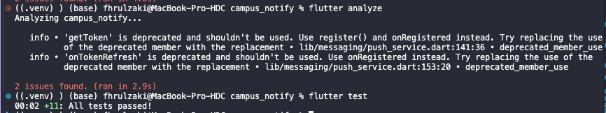

# **Week 6 Authentication, Security, & FCM**

## Praktikum 1: Login + secure storage + token refresh

| struktur folder |
|:---:|
|  |

| flutter analyze dan flutter test |
|:---:|
|  |

### Hasil

| halaman login |
|:---:|
|  |

| login tidak valid |
|:---:|
|  |

| login valid |
|:---:|
|  |

| halaman pengumuman |
|:---:|
|  |

## Praktikum 2: FCM, permission, dan token lifecycle

| notifikasi |
|:---:|
|  |

| console log |
|:---:|
|  |

**Pengujian Notifikasi FCM pada State Background**

Pengujian dilakukan dengan menjalankan aplikasi Campus Notify, kemudian memindahkannya ke background. Notifikasi dikirim melalui Firebase Console dengan target topic `pengumuman-kampus`. Banner notifikasi berhasil muncul pada perangkat Android. Setelah banner diklik, aplikasi Campus Notify terbuka kembali. Pada terminal juga muncul log `Notifikasi dibuka dari background`.

**Hasil:** Berhasil. Notifikasi dapat diterima dan dibuka ketika aplikasi berada dalam kondisi background.

## Praktikum 3: Payload, tiga app state, klik dan topik

| notifikasi |
|:---:|
|  |

| klik banner |
|:---:|
|  |

| console  |
|:---:|
|  |

## AI Challenge

| notifikasi foreground  |
|:---:|
|  |

| notifikasi subscribe  |
|:---:|
|  |

| klik notifikasi |
|:---:|
|  |

| console klik |
|:---:|
|  |

## Refactoring, testing, dan error umum

| test  |
|:---:|
|  |

## Checklist Verifikasi Mandiri

- [x] Token disimpan menggunakan `flutter_secure_storage`, bukan SharedPreferences. Tampilan token pada log dibatasi dan tidak menampilkan token secara penuh.
- [x] Mekanisme refresh token diperiksa. Pengujian refresh gagal berhasil membuktikan bahwa token dihapus sehingga pengguna harus login kembali. Mekanisme refresh sukses dan retry satu kali belum diuji secara terpisah.
- [x] Ketiga kondisi aplikasi (foreground, background, dan terminated) telah diuji. Notifikasi berhasil diterima dan klik notifikasi mengarahkan ke rute yang benar.
- [x] Topik digunakan untuk broadcast, sedangkan token perangkat digunakan untuk pengiriman pesan personal.
- [x] Seluruh 11 pengujian berhasil dijalankan menggunakan `flutter test`.
- [ ] `flutter analyze` bersih tanpa informasi deprecated. Saat ini masih terdapat 2 informasi deprecated pada `getToken()` dan `onTokenRefresh` di `push_service.dart`.